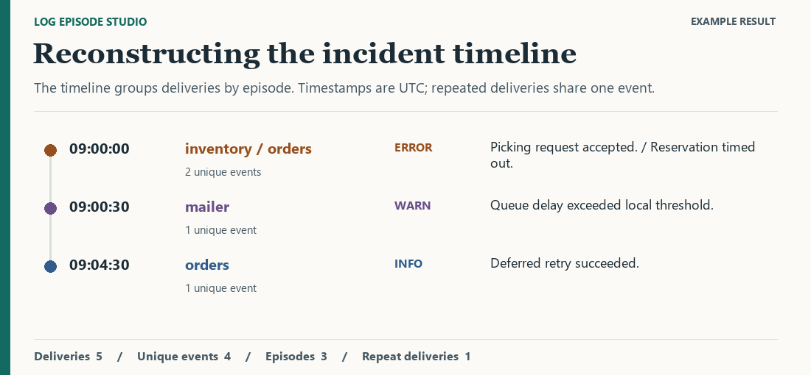
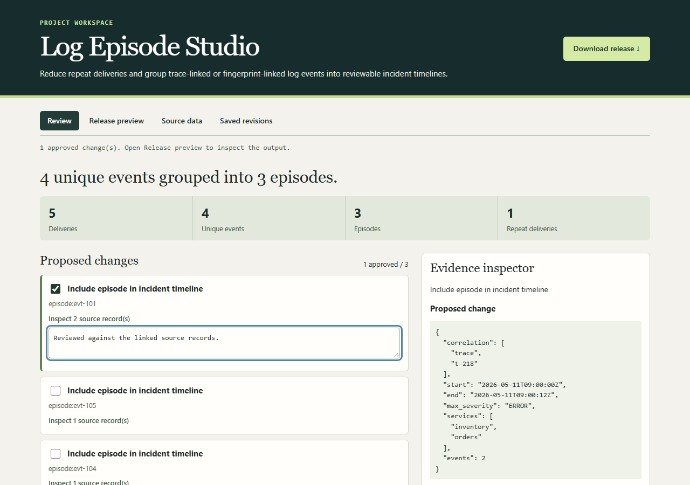

# Log Episode Studio

Reduce repeat deliveries and group trace-linked or fingerprint-linked log events into reviewable incident timelines.

**[Open the live demo](https://oguzhanozfe.github.io/log-episode-studio/)** · [](https://github.com/oguzhanozfe/log-episode-studio/actions/workflows/check.yml) · [Deploy to Render](https://render.com/deploy?repo=https://github.com/oguzhanozfe/log-episode-studio) · [Input guide](GUIDE.md)

Repeated events make an incident look larger than it was. Group related log records into timelines and retain the original identifiers for investigation.



The live demo lets you edit the input, search proposed changes with an on-device model and download the result. [Browser demo details](demo/DEMO.md)

## Try it

With Python 3.11+ installed, clone this repository and run:

```sh
git clone https://github.com/oguzhanozfe/log-episode-studio.git
cd log-episode-studio
python app.py
```

Open <http://127.0.0.1:8000>. The synthetic example is loaded. Select a proposed change, inspect its source records, and open **Release preview** to see the resulting files. Choose **Download release** to save them.

## Walk through the example

Supply structured event records with unique source IDs, timezone-aware timestamps, service names, severity and messages. Use a trace ID when available. Untraced events require an explicit fingerprint and are grouped only with events from the same service. This avoids joining unrelated services solely because their timestamps happen to be close.

**What the engine finds.** 4 unique events grouped into 3 episodes.

**Try this decision.** Approve **Include episode in incident timeline**. The [example review](docs/example-review.json) lists the supporting record IDs and the checksum of each exported file. Its native outputs are [`incident-timeline.jsonl`](docs/example-release/incident-timeline.jsonl), [`episode-index.csv`](docs/example-release/episode-index.csv).

Reproduce that release at the command line:

```sh
python app.py analyze example.json
python app.py export example.json --approve "episode:evt-101" --out reviewed.zip
```

## Model-assisted review

With a local model in Ollama or LM Studio, Azure OpenAI, Amazon Bedrock, or a compatible API connected, select **Request suggestions**. The model examines up to eight candidate actions. Each displayed suggestion links to one of that action's source records. Approving a change and recording a review note remain explicit reviewer actions.

The app runs locally with Python's standard library. The Docker image includes the Bedrock SDK and the production web server. The same UI can save immutable revisions, reopen a workspace and compare decisions. See [model settings, Docker deployment and the HTTP API](docs/deployment.md).



## Development

The domain algorithm and exporter live in [pipeline.py](pipeline.py). The [method guide](GUIDE.md) describes its input assumptions and limitations. Install test dependencies and run the suite:

```sh
python -m pip install -r requirements.txt
python -m unittest discover -v
```

[MIT license](LICENSE)
